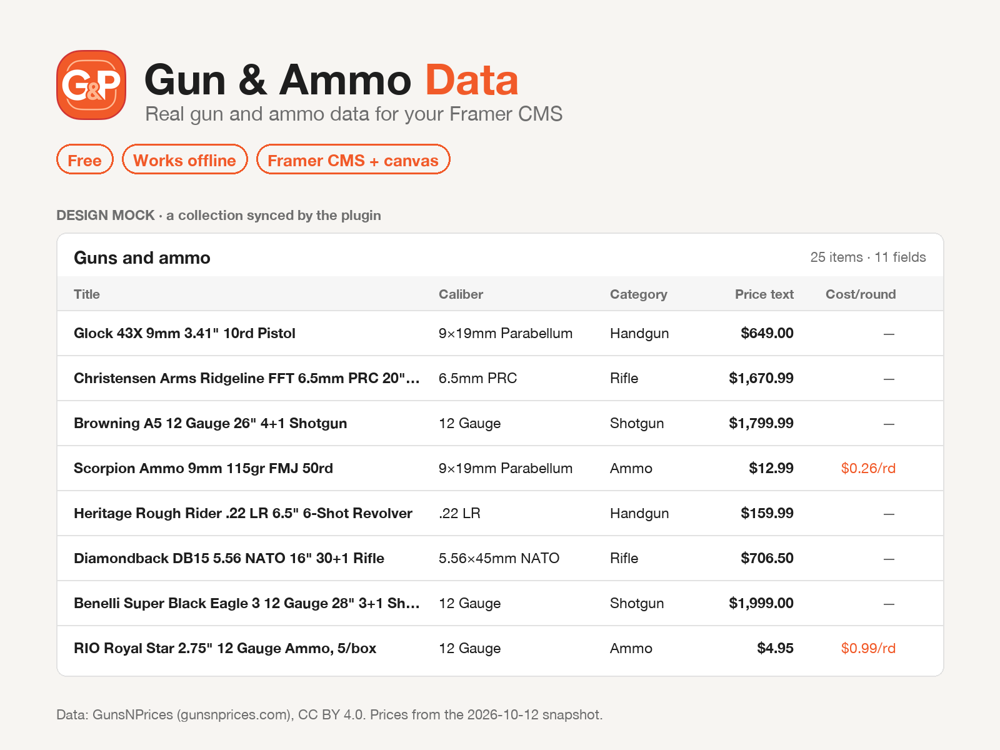

# Gun & Ammo Data, a plugin for Framer

Gun & Ammo Data fills a Framer CMS collection with real firearm and ammunition data, so you can design a gun store,
an ammo shop or a shooting blog with content that looks like the real thing. It also adds the cost per round of an
ammo box to the canvas as a text layer.



The data is a snapshot of the catalog of [GunsNPrices](https://gunsnprices.com), a price comparison site for US gun
and ammo stores. It ships inside the plugin. The plugin makes no network requests, has no account and collects
nothing.

## CMS collection

1. In the CMS, add a new collection and choose **Gun & Ammo Data** (or open the plugin on a collection it created).
2. Pick the data:
   - **Calibers**: cartridge names, their type and the spellings stores use. 293 calibers.
   - **Guns and ammo**: sample products with brand, model, caliber, price and cost per round. 1,045 handguns,
     740 rifles, 320 shotguns and 736 ammo boxes.
3. Choose what to include, how many items, and which fields.
4. Click **Import**. Later, **Sync** in the CMS repeats the same settings without opening the panel.

Items come most listed first. For guns and ammo the categories take turns (handgun, rifle, shotgun, ammo, handgun
...), and ammo boxes take turns by caliber, so a short list is varied. The same settings always give the same items.

If new settings would remove items or fields from the collection, the plugin asks first: layers bound to a removed
field lose their content.

Framer plans limit CMS items per site (Basic: 1,000; see [framer.com/pricing](https://www.framer.com/pricing)). The
panel warns when you pick more.

### Calibers fields

| Field | Type | Example | On by default |
|---|---|---|---|
| Name | Text | 9×19mm Parabellum | always |
| Type | Option | Handgun, Rifle, Rimfire, Shotgun, Airgun, Muzzleloader | yes |
| Aliases | Text | 9mm, 9x19, 9x19 mm, 9mm Luger ... | yes |
| Listings | Number | 10605 (gun and ammo listings on GunsNPrices) | no |
| Price page | Link | https://gunsnprices.com/ammo/handgun-ammo/9-19mm-parabellum | no |

Slug: from the name, e.g. `9x19mm-parabellum`, `38-sw-special`.

### Guns and ammo fields

| Field | Type | Gun example | Ammo example | On by default |
|---|---|---|---|---|
| Title | Text | Glock 43X 9mm 3.41" 10rd Pistol | Scorpion Ammo 9mm 115gr FMJ 50rd | always |
| Brand | Text | Glock | Scorpion | yes |
| Model | Text | Glock 43X | (empty) | yes |
| Caliber | Text | 9×19mm Parabellum | 9×19mm Parabellum | yes |
| Category | Option | Handgun, Rifle, Shotgun | Ammo | yes |
| Capacity | Number | 10 | (empty) | yes |
| Barrel length | Number, inches | 3.41 | (empty) | no |
| Rounds per box | Number | (empty) | 50 | yes |
| Price | Number, USD | 649 | 12.99 | yes |
| Price text | Text | $649.00 | $12.99 | yes |
| Lowest price | Number, USD | 448 | 12.99 | no |
| Cost per round | Number, USD | (empty) | 0.26 | yes |
| Cost per round text | Text | (empty) | $0.26/rd | yes |
| Specs | Text | 9×19mm Parabellum · 3.41" · 10 rounds | 9×19mm Parabellum · 50 rounds · $0.26/rd | no |
| Price page | Link | https://gunsnprices.com/guns/glock-43x | caliber price page | no |

Slug: from the title, e.g. `glock-43x-9mm-3-41-10rd-pistol`.

**Price page** is off by default. When you turn it on, each item links to its price comparison page on
gunsnprices.com: the caliber's ammo prices for calibers and ammo boxes, the model (or model family, or brand guide)
for guns. 59 rare calibers have no page; their link stays empty.

## Cost per round on the canvas

Open the plugin from the toolbar on the canvas. Pick a caliber or search ("federal 124gr"), select an ammo box, pick
a format, and click **Add text layer**.

| Format | Example |
|---|---|
| Per round | $0.26/rd |
| Cents | 26¢/rd (a dollar or more stays in dollars) |
| Words | $0.26 per round |
| Full | $12.99 · 50 rounds · $0.26/rd |

## The data

| | |
|---|---|
| Firearms | 2,105 models from 49 brands: 1,045 handguns, 740 rifles, 320 shotguns |
| Ammo | 736 boxes in 85 calibers |
| Calibers | 293, with 326 retailer spellings |
| Prices | in-stock US store prices on 2026-10-12, before shipping and tax |

It comes from the open [firearm datasets](https://github.com/gunsnprices/firearm-datasets) of GunsNPrices and the
data of the [GunsNPrices Figma plugin](https://github.com/gunsnprices/figma-gunsnprices). A gun's price is the
median in-stock price of its listings; its lowest price is the lowest one. Ammo titles are real store titles.
`npm run data` rebuilds `src/data/catalog.json` (see `scripts/build-data.mjs`).

It is a one-day snapshot for designs, not a price list. For current prices see [gunsnprices.com](https://gunsnprices.com).

## Privacy

- The plugin sends no data anywhere and loads nothing from the network. Framer's standard plugin stylesheet loads
  the Inter font from Framer's own server (framerusercontent.com).
- It saves the collection settings (data set, types, number of items, fields) and the data date on the collection,
  as plugin data. Collaborators on the project can see them.
- On the canvas it saves the last caliber and format in your browser's local storage.
- No account, no analytics, no tracking.

## Development

```bash
npm install
npm run dev          # https://localhost:5173, then in Framer: Plugins → Open Development Plugin
npm run check        # type-check and unit tests
npm run build        # dist/
npm run pack         # dist/plugin.zip for the Marketplace
```

The first `npm run dev` creates a local HTTPS certificate with mkcert and may ask for your password to trust it.
`PLUGIN_HTTP=1 npm run dev` serves plain HTTP instead.

The code: `src/core` builds the fields and items and has no Framer API calls (unit-tested in `test/`),
`src/cms` writes them into the managed collection, `src/canvas` is the canvas panel. `npm run assets` renders the
icon and the Marketplace thumbnails with Pillow.

## License

Code: MIT, see [LICENSE](LICENSE). Data in `src/data/catalog.json`:
[CC BY 4.0](https://creativecommons.org/licenses/by/4.0/), see [LICENSE-DATA](LICENSE-DATA).
**Data: GunsNPrices (gunsnprices.com), CC BY 4.0.**

Questions and corrections: app@gunsnprices.com or
[GitHub issues](https://github.com/gunsnprices/framer-gunsnprices/issues).
